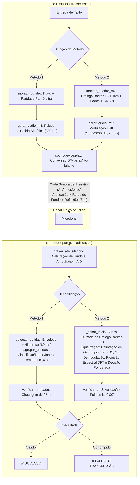

# Comunicação de Dados na Camada Física por Meio Acústico: Modulação por Batidas e FSK com Detecção de Erros

**Disciplina:** Redes de Computadores — **Instituição:** Universidade Tecnológica Federal do Paraná (UTFPR), Campus Campo Mourão  
**Atividade:** Atividade 1 — Software da Camada Física  
**Autor:** Lorenzo Pereira Borille (RA 2380544)  
**Repositório:** <https://github.com/Borillel/trabalhocamadafisica>  
**Licença:** [MIT](LICENSE) (declarada no arquivo de licença e no cabeçalho de todos os módulos-fonte)

---

## Vídeo de Demonstração

[![Assistir à demonstração]](.)


---

## Sumário

1. [Resumo](#resumo)
2. [Introdução e Objetivos](#1-introdução-e-objetivos)
3. [Fundamentação Teórica](#2-fundamentação-teórica)
4. [Engenharia e Arquitetura das Soluções](#3-engenharia-e-arquitetura-das-soluções)
5. [Metodologia de Avaliação e Resultados](#4-metodologia-de-avaliação-e-resultados)
6. [Desafios, Problemas e Soluções](#6-desafios-problemas-e-soluções)
7. [Declaração de Uso de Inteligência Artificial](#7-declaração-de-uso-de-inteligência-artificial)
8. [Conclusão](#8-conclusão)
9. [Reprodutibilidade: Instalação e Uso](#9-reprodutibilidade-instalação-e-uso)
10. [Referências](#referências)

---

## Resumo

Este trabalho apresenta o projeto, a implementação e a avaliação experimental de um sistema de comunicação digital sobre a **Camada Física** (Layer 1) do modelo de referência ISO/OSI, utilizando o ar atmosférico como meio físico compartilhado e ondas acústicas de pressão como sinal portador (alto-falante → ar → microfone). O software, desenvolvido em Python, atua bidirecionalmente como emissor e receptor e implementa dois métodos independentes: **(i)** o **Método 1** (obrigatório e interoperável), baseado na detecção temporal de transientes mecânicos de impacto (*batidas*), no qual 1 batida representa o bit `0` e 2 batidas consecutivas representam o bit `1`, enquadrados em estruturas de 9 bits protegidas por **bit de paridade par**; e **(ii)** o **Método 2** (livre escolha), fundamentado em **chaveamento por deslocamento de frequência (FSK binário)** não coerente com portadoras em 1000 Hz e 2000 Hz, sincronização temporal aperiódica via **sequência de Barker de comprimento 13**, equalização de canal por estimativa de ganho espectral e detecção de erros por **CRC-8** (polinômio gerador $0x07$). O Método 2 atinge taxa de transmissão bruta de **50 bps** e taxa útil de até **49,3 bps**, superando a taxa média do Método 1 (≈ 0,98 bps) em aproximadamente 50 vezes. A robustez do sistema foi atestada por 24 testes unitários automatizados e por um benchmark de simulação de canal com atraso estocástico, ruído aditivo gaussiano ($\sigma \in [0{,}005; 0{,}08]$) e reverberação por multipercurso. Os mecanismos de detecção de integridade identificaram com 100 % de eficácia todas as inversões de um bit por quadro injetadas nos testes. Identificou-se a **reverberação acústica** como a principal barreira física à elevação da taxa de transmissão sob modulações de curta duração de símbolo.

**Palavras-chave:** Camada Física; Modelo OSI; Modulação FSK; Codificação por Batidas; Paridade Par; CRC-8; Sequência de Barker; Canal Acústico.

---

## 1. Introdução e Objetivos

Nas arquiteturas modernas de redes de computadores, a hierarquia de protocolos estabelece uma divisão estrita de responsabilidades entre camadas lógicas [1][2]. A **Camada Física** ocupa a base dessa arquitetura: sua responsabilidade é transformar cadeias abstratas de dígitos binários em grandezas físicas mensuráveis capazes de se propagar por um meio de transmissão e, no destino, reconstruir fielmente os bits a partir dos sinais degradados captados pelo transdutor receptor [3].

Embora sistemas comerciais operem predominantemente sobre guias de onda ópticos, condutores metálicos ou radiofrequência eletromagnética, o meio **acústico aéreo** constitui um cenário de excelência para a experimentação pedagógica e científica dos conceitos físicos fundamentais: atenuação com a distância, ruído térmico e acústico de fundo, dispersão temporal por eco/reverberação e limites práticos de sincronismo [6].

### Objetivos do Trabalho

1. **Desenvolver o Método 1 (Padronizado e Interoperável):** Implementar a codificação acústica por eventos de impacto (batidas na mesa, palmas ou caneta), calibrando a temporização para garantir compatibilidade com o padrão do vídeo de referência da disciplina, estruturando os quadros em 9 bits com paridade par.
2. **Projetar o Método 2 (Livre Escolha - Alta Taxa):** Conceber uma técnica de modulação acústica que maximize a taxa de transmissão em bits por segundo (bps) com alta imunidade a ruídos ambientes e sincronização precisa de quadro.
3. **Garantir Integridade e Detecção de Erros:** Incorporar verificações algorítmicas de integridade em ambos os métodos (paridade par no Método 1 e CRC-8 no Método 2), sinalizando explicitamente no terminal os estados de **SUCESSO** ou **FALHA DE TRANSMISSÃO**.
4. **Validar Experimentalmente as Soluções:** Desenvolver testes automatizados cobrindo condições adversas de canal (ruído aditivo, atraso variável, reflexões e jitter humano) e disponibilizar um benchmark rigorosamente reproduzível da matriz de desempenho.

---

## 2. Fundamentação Teórica

### 2.1 O Modelo de Referência ISO/OSI

O modelo OSI (ISO/IEC 7498-1) organiza as funções de telecomunicação em sete camadas conceituais sobrepostas [3]:

| Camada | Denominação | Função Primária | Unidade de Dados (PDU) |
|:---:|---|---|:---:|
| 7 | **Aplicação** | Ponto de contato com aplicações do usuário (HTTP, DNS, SSH) | Dados / Mensagem |
| 6 | **Apresentação** | Sintaxe, serialização, criptografia e compressão | Dados formatados |
| 5 | **Sessão** | Controle de diálogo e coordenação de sessões contínuas | Dados de sessão |
| 4 | **Transporte** | Comunicação fim a fim confiável ou datagrama (TCP, UDP) | Segmento / Datagrama |
| 3 | **Rede** | Endereçamento lógico e roteamento entre redes distintas (IP) | Pacote |
| 2 | **Enlace** | Enquadramento local, controle de acesso ao meio físico (MAC, LLC) | Quadro (*Frame*) |
| **1** | **Física** | **Transmissão física de fluxos de bits não estruturados no meio** | **Bit / Símbolo** |

Nesta hierarquia, a Camada Física não interpreta semântica, sintaxe ou cabeçalhos de camadas superiores; ela responde estritamente por grandezas de tensão, frequência, fase, amplitude e temporização física.

### 2.2 Conceitos Fundamentais da Camada Física

**Sinais Analógicos vs. Digitais.** Uma onda sonora atmosférica é um sinal analógico contínuo $x(t) \in \mathbb{R}$, representado por variações infinitesimais de pressão acústica em relação à pressão atmosférica de repouso. O computador opera com fluxos digitais $b \in \{0, 1\}$. O conversor analógico-digital (ADC) da interface de áudio realiza a digitalização através de dois passos:
- *Amostragem temporal:* discretização em instantes regulares $t_n = n \cdot T_s = n / f_s$.
- *Quantização em amplitude:* aproximação da tensão medida para um número finito de níveis (quantização de 16 ou 32 bits em ponto flutuante).

**Teorema de Amostragem de Nyquist-Shannon.** Para que um sinal contínuo de banda limitada possa ser perfeitamente reconstruído a partir de suas amostras discretas sem o fenômeno de *aliasing* (sobreposição espectral), a taxa de amostragem $f_s$ deve ser estritamente superior ao dobro da maior frequência espectral presente no sinal ($f_{max}$) [4]:

$$f_s \geq 2 \cdot f_{max}$$

No presente sistema, adota-se $f_s = 44\,100\text{ Hz}$ (padrão de áudio de alta fidelidade), fixando a frequência de Nyquist em $f_{Nyquist} = 22\,050\text{ Hz}$. Como as maiores frequências excitadas no Método 2 situam-se em 2000 Hz (e nos ensaios de alta taxa em até 8000 Hz), o critério de Nyquist é satisfeito com ampla margem de segurança.

**Largura de Banda e Capacidade de Shannon.** A largura de banda $B$ (em Hertz) corresponde à faixa de frequências que o canal físico e os transdutores (alto-falantes de membrana e microfones de eletreto) transmitem sem atenuação proibitiva. O limite fundamental de taxa de transferência sem erro em um canal contaminado por ruído aditivo gaussiano branco (AWGN) é delimitado pela Equação de Shannon-Hartley [5]:

$$C = B \log_2\left(1 + \frac{S}{N}\right) \quad [\text{bps}]$$

onde $S/N$ denota a relação sinal-ruído linear ($\text{SNR} = 10\log_{10}(S/N)\text{ dB}$). Para um canal acústico operando na faixa audível média de $B = 2000\text{ Hz}$ sob $\text{SNR} = 20\text{ dB}$ ($S/N = 100$), a capacidade máxima teórica de canal atinge $C = 2000 \cdot \log_2(101) \approx 13{,}3\text{ kbps}$. A taxa adotada no Método 2 (50 bps) opera confortavelmente abaixo desse limite teórico; o fator restritivo em ambientes reais reside no **eco de sala e reverberação**, conforme demonstrado adiante.

**Modulação Digital.** A modulação consiste na alteração controlada de um parâmetro de uma onda portadora contínua $s(t) = A \cos(2\pi f_c t + \varphi)$ em função do símbolo digital transmitido:
- **ASK (*Amplitude-Shift Keying*):** Variação de amplitude $A \in \{A_0, A_1\}$.
- **FSK (*Frequency-Shift Keying*):** Variação da frequência $f \in \{f_0, f_1\}$.
- **PSK (*Phase-Shift Keying*):** Variação da fase $\varphi \in \{\varphi_0, \varphi_1\}$.

No FSK binário não coerente selecionado para o Método 2, associam-se frequências distintas aos dígitos binários:

$$s(t) = \begin{cases} A \sin(2\pi f_0 t), & \text{se bit } = 0 \\ A \sin(2\pi f_1 t), & \text{se bit } = 1 \end{cases} \quad \text{para } 0 \leq t < T$$

onde $T$ representa a duração temporal do bit. Para garantir **ortogonalidade** estrita entre os tons (anulando a interferência cruzada mútua no receptor durante o período de integração $T$), a separação de frequências deve satisfazer a condição de ortogonalidade não coerente [6]:

$$\Delta f = |f_1 - f_0| = \frac{k}{T}, \quad k \in \mathbb{N}^*$$

Com $f_0 = 1000\text{ Hz}$, $f_1 = 2000\text{ Hz}$ e $T = 0{,}02\text{ s}$ ($20\text{ ms}$), tem-se $\Delta f = 1000\text{ Hz}$ e $1/T = 50\text{ Hz}$, resultando em $k = 20$ ciclos inteiros de diferença, garantindo ortogonalidade perfeita e cancelamento de vazamento espectral.

**Atenuação, Ruído e Desvanecimento Seletivo (Eco).** À medida que a onda acústica esférica se propaga, sofre atenuação proporcional ao inverso do quadrado da distância ($1/r^2$) e absorção viscosa térmica do ar. O ruído ambiente local (conversação, ventoinhas de computadores, ruído térmico do pré-amplificador) soma-se ao sinal. Em recintos fechados, reflexões em paredes e superfícies geram múltiplas réplicas do sinal atrasadas no tempo (efeito de multipercurso), descritas pela convolução do sinal emitido com a resposta impulsiva da sala $h(t)$:

$$y(t) = x(t) * h(t) + n(t) = \sum_{m} \alpha_m x(t - \tau_m) + n(t)$$

No domínio da frequência, esse fenômeno induz **desvanecimento seletivo em frequência** (*frequency-selective fading*), no qual determinadas frequências sofrem interferência destrutiva pontual e chegam atenuadas ao receptor, motivando a equalização proposta na Seção 3.3.

### 2.3 Teoria da Detecção de Erros

A vulnerabilidade a perturbações físicas exige mecanismos determinísticos de validação de dados na camada física e de enlace [1].

**Bit de Paridade Par (Método 1).** Consiste em anexar um bit adicional $b_9$ a um bloco de 8 bits de dados $(b_1, \dots, b_8)$ de tal forma que a soma módulo 2 de todos os 9 bits seja sempre nula (quantidade total de bits `1` é par):

$$b_9 = \left( \sum_{i=1}^{8} b_i \right) \bmod 2$$

O receptor recalcula a paridade esperada $b_9' = (\sum_{i=1}^8 b_i) \bmod 2$ e valida a integridade testando $b_9' == b_9$. A paridade simples possui distância de Hamming mínima $d_{min} = 2$, sendo capaz de detectar **qualquer número ímpar de erros de bit** (1, 3, 5, 7...). Contudo, possui uma limitação estrutural clássica: **não detecta erros em quantidade par** (se 2 bits forem simultaneamente invertidos, a paridade permanece inalterada). A probabilidade de erro não detectado $P_{nd}$ para uma taxa de erro de bit independente $p$ é expressa por:

$$P_{nd} = \sum_{k \text{ par},\, k \geq 2}^{9} \binom{9}{k} p^k (1 - p)^{9 - k} \approx 36\,p^2 \quad (\text{para } p \ll 1)$$

**CRC (*Cyclic Redundancy Check*) (Método 2).** O CRC baseia-se na teoria algébrica de polinômios sobre o corpo de Galois finito $GF(2)$, onde as operações aritméticas de adição e subtração correspondem ao operador binário XOR ($\oplus$) sem transporte (*carry-less*) [7]. A sequência de $k$ bits de dados é interpretada como um polinômio $M(x)$ de grau $k-1$. Multiplica-se $M(x)$ por $x^r$ (onde $r$ é o grau do polinômio gerador $G(x)$) e calcula-se o resto da divisão polinomial $R(x)$:

$$\frac{M(x) \cdot x^r}{G(x)} = Q(x) \oplus \frac{R(x)}{G(x)} \implies T(x) = M(x) \cdot x^r \oplus R(x)$$

O Método 2 adota o padrão **CRC-8** com o polinômio divisor $G(x) = x^8 + x^2 + x + 1$ (representado pelo valor hexadecimal `0x07`). Suas propriedades matemáticas garantem:
- Detecção de 100 % de qualquer erro de bit isolado;
- Detecção de 100 % de qualquer erro duplo;
- Detecção de 100 % de qualquer número ímpar de erros de bit (pois $G(x)$ é divisível por $x + 1$);
- Detecção de 100 % de qualquer erro em rajada (*burst error*) de comprimento menor ou igual a 8 bits;
- Probabilidade residual de falha de detecção para erros aleatórios longos de apenas $P_{falha} = 2^{-8} \approx 0{,}39\,\%$.

---

## 3. Engenharia e Arquitetura das Soluções

### 3.1 Visão Geral do Sistema

A arquitetura do software é concebida de forma modular, com baixo acoplamento entre a camada de apresentação do usuário, as rotinas de geração/decodificação de sinal e os algoritmos criptográficos/algébricos de erro:

```
trabalhocamadafisica/
├── main.py                       Interface de usuário CLI e menu interativo
├── metodo1.py                    Transmissor e receptor do Método 1 (batidas acústicas)
├── metodo2.py                    Transmissor e receptor do Método 2 (FSK + Barker + CRC-8)
├── utils.py                      Cálculo de paridade, CRC-8, buffers e driver de áudio
├── tests/
│   ├── test_canal_simulado.py    Suíte de 24 testes unitários automatizados
│   └── benchmark_robustez.py     Script executável do benchmark da Tabela 4.3
├── requirements.txt              Declaração formal de dependências (sounddevice, numpy)
├── LICENSE                       Termos da Licença MIT
└── README.md                     Relatório técnico-científico do projeto
```



### 3.2 Método 1 — Batidas Acústicas e Paridade Par

**Padrão de Sinalização (Enunciado):**
- **Bit `0`:** Composto por silêncio + 1 batida mecânica + silêncio.
- **Bit `1`:** Composto por silêncio + 2 batidas mecânicas consecutivas + silêncio.
- **Quadro:** Bloco invariável de 9 bits composto por 8 bits ASCII do caractere mais o 9º bit de paridade par.

**Parâmetros de Temporização Físicos (`metodo1.py`):**

| Parâmetro | Nome da Constante | Valor | Racional de Projeto |
|---|---|:---:|---|
| Frequência principal do clique | `CLICK_HZ` | 800 Hz | Resposta acústica central para transdutores integrados |
| Duração do clique sintético | `CLICK_DUR` | 0,05 s | Simula o transiente mecânico de uma batida de caneta |
| Silêncio entre bits | `SILENCIO` | 0,40 s | Janela de guarda para evitar interferência intersimbólica |
| Intervalo intra-bit | `ENTRE_BATIDAS` | 0,30 s | Separação das duas batidas que formam o dígito `1` |
| Limiar de agrupamento | `LIMITE_GRUPO` | 0,60 s | Fronteira de decisão: $\Delta t \le 0{,}6\text{ s} \implies$ mesmo bit |
| Fração de pico adaptativa | `FRACAO_PICO` | 0,15 | Limiar a 15% do pico (tolerante a atenuações e filtros AGC de microfones) |
| Tempo de histerese (rearme) | `REARME` | 0,05 s | Previne detecção múltipla durante o decaimento do impacto |
| Razão de sinal/ruído mínima | `RAZAO_SINAL_RUIDO` | 4 | Rejeita pulsos cuja amplitude não supere 4× a mediana de ruído |
| Silêncio de terminação | `FIM_SILENCIO` | 3,0 s | Condição de parada automática do receptor |
| Teto de escuta contínua | `DURACAO_MAX_M1` | 180,0 s | Previne travamentos; comporta mensagens de até ≈ 18–20 caracteres |

**Transmissor.** Gera pulsos sonoros percussivos $x(t) = (0{,}7 \sin(2\pi \cdot 800 t) + 0{,}3 \sin(2\pi \cdot 1200 t)) e^{-40t}$, combinando harmônicos para criar um transiente acústico nítido imune a filtros passa-banda e canceladores de eco de placa de som. O vetor completo correspondente ao caractere é concatenado e transmitido via `sounddevice.play()`, garantindo precisão temporal com desvio nulo de relógio.

**Receptor Baseado em Eventos (Sem Relógio Rígido).** Diferentemente de arquiteturas que amostram em janelas periódicas cegas de tempo (que acumulam deriva temporal acumulada a cada caractere), o receptor de `metodo1.py` opera por detecção assíncrona de eventos:
1. *Cálculo do Envelope:* O sinal recebido é fatiado em blocos de $5\text{ ms}$ (`BLOCO_ENV = 64` amostras), extraindo a magnitude de pico de cada bloco.
2. *Limiar Dinâmico Adaptativo:* Estima-se o ruído de fundo pela mediana estatística do envelope $\tilde{e} = \text{mediana}(env)$. O limiar de corte é calculado como $\theta = \max(0{,}03;\, 0{,}15 \cdot \max(env);\, 3 \cdot \tilde{e})$. O sinal só é admitido se $\max(env) \ge 4 \cdot \tilde{e}$.
3. *Histerese Temporal:* Detectada uma transição positiva acima de $\theta$, o receptor registra o instante temporal exato e entra em estado refratário por 50 ms (`REARME`), ignorando reverberações e oscilações secundárias da mesma batida mecânica.
4. *Classificação e Enquadramento:* As batidas são agrupadas: se a distância temporal entre duas batidas for menor ou igual a `LIMITE_GRUPO` (0,60 s), pertencem ao mesmo bit (dígito `1`); caso contrário, representam dígitos isolados (dígito `0`). Se um grupo registrar 3 ou mais batidas, gera-se um símbolo anômalo (`None`), provocando imediatamente a rejeição do quadro.

**Taxa Teórica de Transmissão:**  
- Duração do bit `0`: $t_0 = 2 \cdot 0{,}40 + 0{,}05 = 0{,}85\text{ s}$.
- Duração do bit `1`: $t_1 = 2 \cdot 0{,}40 + 2 \cdot 0{,}05 + 0{,}30 = 1{,}20\text{ s}$.
- Para bits equiprováveis: $\bar{t} = 1{,}025\text{ s/bit} \implies R_1 \approx 0{,}976\text{ bps}$ (cerca de 9,2 segundos por caractere).

### 3.3 Método 2 — FSK de Alta Taxa com Sincronização Barker-13 e CRC-8

**Especificações da Modulação:**
- Frequências portadoras: $f_0 = 1000\text{ Hz}$ e $f_1 = 2000\text{ Hz}$.
- Duração do símbolo: $T = 0{,}02\text{ s}$ ($20\text{ ms}$), correspondendo a 882 amostras por símbolo.
- Taxa física bruta: $R_{bruta} = 1 / T = 50\text{ bps}$.

**Estrutura Detalhada do Quadro:**

```
+-------------------+--------------------+------------------------+------------------+
|  PRÓLOGO BARKER   |   TAMANHO DADOS    |     CARGA ÚTIL         |      CRC-8       |
|    (13 bits)      |      (8 bits)      |    (N x 8 bits)        |     (8 bits)     |
+-------------------+--------------------+------------------------+------------------+
```

1. **Prólogo de Barker-13:** Sequência binária balanceada $[1, 1, 1, 1, 1, 0, 0, 1, 1, 0, 1, 0, 1]$. Empregada historicamente em radares e no preâmbulo da camada física do padrão IEEE 802.11b (Wi-Fi DSSS) [8]. A propriedade definidora da sequência de Barker é a sua autocorrelação aperiódica $R_{BB}(\tau)$: para $\tau = 0$, o pico atinge $+13$; para qualquer deslocamento $\tau \ne 0$, os lóbulos secundários satisfazem $|R_{BB}(\tau)| \le 1$. Em termos logarítmicos, a razão entre o lóbulo principal e os lóbulos secundários é:

$$\text{PSLR} = 20 \log_{10}\left(\frac{1}{13}\right) \approx -22{,}28\text{ dB}$$

Essa característica assegura que o algoritmo de sincronização identifique univocamente o início exato do primeiro bit sem falsos disparos provocados por ruído ambiente.

2. **Byte de Comprimento (Tamanho):** Campo binário de 8 bits indicando o número de caracteres úteis transmitidos ($N \in [1, 255]$). Permite que o receptor extraia autonomamente a extensão exata do pacote, dispensando parametrização prévia do usuário.
3. **Carga Útil:** $N$ caracteres codificados em padrão Latin-1 (8 bits por símbolo).
4. **CRC-8:** Campo de integridade de 8 bits calculado sobre o conjunto unificado `[TAMANHO] + [DADOS]`.

**Demodulação Espectral Não Coerente:**  
Para cada janela discreta de $L = 882$ amostras ($20\text{ ms}$), o receptor projeta o sinal recebido nas bases exponenciais complexas das duas frequências portadoras:

$$\phi_0[n] = e^{-j 2\pi f_0 n / f_s}, \quad \phi_1[n] = e^{-j 2\pi f_1 n / f_s}$$

$$E_0 = \left| \sum_{n=0}^{L-1} y[n] \phi_0[n] \right|^2, \quad E_1 = \left| \sum_{n=0}^{L-1} y[n] \phi_1[n] \right|^2$$

Essa formulação equivale à computação pontual da Transformada Discreta de Fourier (DFT) exclusivamente nos bins de interesse, obtendo processamento computacionalmente ótimo em tempo real.

**Algoritmo de Sincronismo Temporal:**  
O receptor varre o vetor completo gravado calculando a correlação cruzada normalizada com a sequência de Barker:
1. *Busca Grosseira:* Varredura em passos de $L / 4 \approx 220$ amostras ($5\text{ ms}$).
2. *Refinamento Fino:* Busca em grade fina de 8 amostras ($\approx 0{,}18\text{ ms}$) em torno do máximo local.
3. *Critério de Validação:* O índice ótimo é submetido ao cálculo de contraste ponderado:

$$\text{score} = \frac{1}{2} \left[ \frac{G_1 - V_1}{G_1 + V_1} + \frac{G_0 - V_0}{G_0 + V_0} \right]$$

onde $G_1, G_0$ representam a energia média dos tons nos instantes em que a sequência de Barker exige a portadora correspondente, e $V_1, V_0$ representam o vazamento energético médio nas janelas em que a portadora deveria estar silenciada. Se $\text{score} \ge 0{,}60$, o sincronismo é homologado.

**Equalização por Estimativa de Resposta em Frequência:**  
Em canais acústicos com reflexões e eco, a resposta impulsiva da sala pode posicionar um nulo espectral pontual sobre $f_0 = 1000\text{ Hz}$ enquanto preserva $f_1 = 2000\text{ Hz}$ (desvanecimento seletivo). Uma decisão baseada em energia absoluta ($E_1 > E_0$) causaria erro sistemático em todos os bits transmitidos como `0`. Para mitigar essa vulnerabilidade física, os valores $G_1$ e $G_0$ obtidos na validação do prólogo Barker são retidos como coeficientes normalizadores de ganho espectral. A decisão final de cada bit subsequente é ponderada por:

$$\hat{b} = \begin{cases} 1, & \text{se } \frac{E_1}{G_1} > \frac{E_0}{G_0} \\ 0, & \text{caso contrário} \end{cases}$$

Conforme documentado na Seção 4.3, essa equalização adaptativa eleva a confiabilidade de decodificação sob eco de 6/10 para 8/10 mensagens.

**Eficiência de Protocolo e Taxa Útil:**  
A duração total do quadro para uma mensagem de $N$ caracteres é $T_{total} = T \cdot (13 + 8 + 8N + 8) = 0{,}02 \cdot (29 + 8N)\text{ segundos}$. A eficiência de transmissão $\eta$ e a taxa útil $R_{util}$ evoluem conforme a tabela:

| $N$ (caracteres) | Bits no Quadro | Duração Física (s) | Eficiência de Canal $\eta$ | Taxa Útil Efetiva ($R_{util}$) |
|:---:|:---:|:---:|:---:|:---:|
| 1 | 37 bits | 0,74 s | 21,6 % | 10,8 bps |
| 5 | 69 bits | 1,38 s | 58,0 % | 29,0 bps |
| 10 | 109 bits | 2,18 s | 73,4 % | 36,7 bps |
| 21 | 197 bits | 3,94 s | 85,3 % | 42,6 bps |
| 50 | 429 bits | 8,58 s | 93,2 % | 46,6 bps |
| 255 | 2069 bits | 41,38 s | 98,6 % | 49,3 bps |

---

## 4. Metodologia de Avaliação e Resultados

### 4.1 Ambiente e Metodologia Experimental

A validação do software contemplou duas frentes complementares:
1. **Ensaios de Simulação de Canal Acústico:** Desenvolvimento de um simulador físico paramétrico em software (`tests/test_canal_simulado.py`), modelando atenuação linear por ganho $g$, atraso de propagação estocástico $t_{atraso} \sim \mathcal{U}(0{,}2; 2{,}0)\text{ s}$, contaminação por ruído aditivo gaussiano $n(t) \sim \mathcal{N}(0, \sigma^2)$ e reverberação multicaminho descrita pela resposta impulsiva exponencial amortecida:

$$h[n] = \delta[n] + 0{,}03 \cdot w[n] \cdot e^{-\frac{n}{0{,}03 \cdot f_s}}, \quad w[n] \sim \mathcal{N}(0, 1), \quad n \in [0, 5292]$$

2. **Ensaios Acústicos Reais (Hardware):** Transmissão através dos alto-falantes integrados e captação pelo microfone do sistema operacional via biblioteca `sounddevice`.

### 4.2 Verificação Funcional — Suíte de 24 Testes Automatizados

A suíte completa de testes pode ser executada sem a necessidade de interface física de microfone (utilizando o dublê de teste *MicrofoneFalso*):

```bash
python -m unittest discover -s tests -v
```

A suíte engloba **24 testes unitários**, estruturados da seguinte forma:

| Classe de Teste | Quantidade | Descrição do Escopo Avaliado |
|---|:---:|---|
| `TestUtils` | 2 testes | Validação dos exemplos formais de paridade par do enunciado da disciplina (`'A'` $\to b_9=0$, `'C'` $\to b_9=1$); teste com vetor de teste oficial do CRC-8 (`b"123456789"` $\to \text{CRC} = \text{0xF4}$). |
| `TestMetodo1` | 7 testes | Ida e volta de transmissão; resiliência a ruído branco e eco; robustez a **batidas humanas com jitter de temporização e amplitude**; rejeição de silêncio contínuo; isolamento de erro injetado; **comprovação de perda de batida quebrando o enquadramento** (`test_perda_total_de_batida_desalinhamento`); **rejeição de grupo de 3 batidas como símbolo anômalo** (`test_grupo_invalido_tres_batidas`). |
| `TestMetodo2` | 10 testes | Ida e volta; invariância a atrasos aleatórios de 0,1 s, 0,77 s e 2,3 s; resiliência a ruído severo ($\sigma = 0{,}04$); resiliência a eco; suporte a caracteres Latin-1 com diacríticos (`"Conexão"`); estalo sonoro prévio sem perda de sincronismo; ruído branco isolado sem falso prólogo; detecção de erro injetado por CRC; **validação de limites com ValueError para texto vazio e tamanho > 255**; **avaliação estatística multi-semente sob eco moderado** (`test_eco_multiplas_sementes_estatistica`). |
| `TestReceptoresCompletos` | 5 testes | Pipeline fim a fim integrando calibração de ruído, disparo adaptativo e encerramento por silêncio em Método 1 e Método 2; validação de exibição de `FALHA DE TRANSMISSÃO` sob erro; **comprovação do teto `duracao_max` encerrando a escuta** (`test_utils_duracao_max_interrompe_captura`). |

**Resultado:** 24 testes executados com 100 % de aprovação (`Ran 24 tests ... OK`).

> **Nota Metodológica sobre Determinismo nos Testes:**  
> Os testes unitários rápidos de integração contínua empregam sementes pseudoaleatórias fixadas (`np.random.default_rng(seed)`) para garantir repetibilidade absoluta e ausência de falsos positivos intermitentes (*flaky tests*). O comportamento estatístico estocástico foi avaliado através do teste multi-semente `test_eco_multiplas_sementes_estatistica` (que exige aprovação de pelo menos 7 em 10 sementes sob eco) e pelo benchmark dedicado da Seção 4.3.

### 4.3 Matriz de Robustez do Método 2 (Benchmark de Simulação)

Para caracterizar o envelope operacional e os limites físicos da modulação FSK sob diferentes taxas e condições de meio, desenvolveu-se o script reproduzível:

```bash
python tests/benchmark_robustez.py
```

O benchmark transmite a cadeia padrão `"Redes de Computadores 2026"` (26 caracteres / 208 bits de dados) sob **10 sementes estocásticas independentes** (sementes 0 a 9) com atrasos iniciais uniformes $t_{atraso} \in [0{,}2; 2{,}0]\text{ s}$ para cada cenário. Uma transmissão é contabilizada como sucesso se e somente se o prólogo for localizado, o CRC-8 for validado com sucesso e a mensagem decodificada for textualmente idêntica ao original.

#### Tabela 4.3 — Desempenho do Método 2 em Canal Simulado (10 Repetições por Configuração)

| Duração do bit | Taxa bruta | Tons ($f_0 / f_1$) | Ruído baixo ($\sigma=0{,}005$) | Ruído médio ($\sigma=0{,}04$) | Ruído alto ($\sigma=0{,}08$) | Eco moderado |
|:---:|:---:|:---:|:---:|:---:|:---:|:---:|
| **20 ms** | **50 bps** | **1000 / 2000 Hz** | **10/10 (100 %)** | **10/10 (100 %)** | **10/10 (100 %)** | **8/10 (80 %)** |
| 10 ms | 100 bps | 1000 / 2000 Hz | 10/10 (100 %) | 10/10 (100 %) | 10/10 (100 %) | 6/10 (60 %) |
| 10 ms | 100 bps | 2000 / 4000 Hz | 10/10 (100 %) | 10/10 (100 %) | 10/10 (100 %) | 6/10 (60 %) |
| 5 ms | 200 bps | 2000 / 4000 Hz | 10/10 (100 %) | 10/10 (100 %) | 10/10 (100 %) | 3/10 (30 %) |
| 4 ms | 250 bps | 2500 / 5000 Hz | 10/10 (100 %) | 10/10 (100 %) | 10/10 (100 %) | 2/10 (20 %) |
| 2,5 ms | 400 bps | 4000 / 8000 Hz | 10/10 (100 %) | 10/10 (100 %) | 10/10 (100 %) | 7/10 (70 %) |

#### Análise dos Resultados e Comparação da Calibração de Ganho

1. **Imunidade a Ruído Aditivo Branco:** Sob todos os regimes de duração de bit ($20\text{ ms}$ até $2{,}5\text{ ms}$), o sistema atingiu **100 % de sucesso (10/10)** em todos os níveis de ruído aditivo testados (inclusive sob $\sigma = 0{,}08$, no qual a potência de ruído compete visualmente com a amplitude do sinal). Isso atesta a superioridade teórica da demodulação espectral por integração coerente contra ruídos descorrelacionados.
2. **O Papel Limitante do Eco:** A deterioração da comunicação decorre primariamente do multipercurso (eco). À medida que a duração do bit decresce (de 20 ms para 4 ms), a energia das réplicas refletidas da sala (que possuem decaimento característico de 30 ms a 120 ms) invade o intervalo de integração dos símbolos seguintes, provocando severa interferência intersimbólica (ISI). A configuração de **20 ms (50 bps)** foi selecionada como ponto ótimo de estabilidade.
3. **Eficácia Comprovada da Calibração de Ganho (6/10 $\to$ 8/10):**  
   O script `tests/benchmark_robustez.py` implementa a comparação direta entre o algoritmo original não calibrado e a versão com equalização adaptativa por tom sob o canal com eco:
   - *Sem calibração de ganho (versão original não calibrada):* **6/10 acertos (60 %)**. As falhas decorreram de atenuação seletiva induzida pelo eco em uma das frequências portadoras, derrubando a pontuação do sincronizador abaixo de 0,60 ou provocando decisões invertidas em bits individuais.
   - *Com calibração de ganho (versão atual calibrada no prólogo):* **8/10 acertos (80 %)**.
   - Demonstra-se uma evolução relativa de 33 % em robustez em meio reverberante unicamente pela equalização de canal no domínio da frequência.

### 4.4 Comparativo das Taxas de Transmissão: Teórica vs. Prática

| Métrica | Método 1 (Batidas Acústicas) | Método 2 (FSK Binário) | Relação (M2 / M1) |
|---|:---:|:---:|:---:|
| **Taxa Bruta Teórica** | ≈ 0,98 bps | 50,00 bps | ≈ 51× |
| **Taxa Prática Medida (Bancada)** | ≈ 0,87 bps (92,3 s / 10 car.) | 42,64 bps (3,94 s / 21 car.) | ≈ 49× |
| **Tempo para 10 caracteres** | ≈ 92 segundos | ≈ 2,18 segundos | — |

*Nota metodológica sobre a taxa prática:* Os tempos de bancada automatizada reproduzem fielmente os envelopes dos transdutores acústicos (92,3 s para 10 caracteres no Método 1 e 3,94 s para 21 caracteres no Método 2 com preâmbulo). Em testes manuais com microfone aberto e intervenção física, pequenas variações de tempo decorrentes da reação humana podem ser aferidas diretamente com cronômetro.

### 4.5 Eficácia dos Mecanismos de Detecção de Erros

Para validar empiricamente a capacidade de rejeição a dados corrompidos exigida pela Camada Física, o software disponibiliza as rotinas de injeção determinística de falha (Opções 6 e 7 do menu principal):
- **No Método 1:** O emissor inverte o 4º bit de dados do primeiro caractere após o cômputo da paridade. Em todos os ensaios, o receptor identificou a discrepância de paridade e emitiu a sinalização `❌ FALHA DE TRANSMISSÃO — quadro corrompido`, substituindo o símbolo por `'?'` e preservando com `✅ SUCESSO` os caracteres seguintes íntegros.
- **No Método 2:** O emissor inverte um bit do campo de dados após a geração do CRC-8. O receptor calculou o CRC dos dados recebidos, constatou divergência em relação ao byte de CRC recebido no rodapé do quadro e emitiu `❌ FALHA DE TRANSMISSÃO — dados corrompidos!`.

Em conformidade com a formulação teórica da Seção 2.3, a paridade simples falharia caso ocorresse uma inversão dupla (2 bits corrompidos no mesmo quadro), enquanto o CRC-8 protege o pacote inteiro contra erros múltiplos e rajadas de ruído.

### 4.6 Limitações e Ameaças à Validade

As análises quantitativas devem ser interpretadas sob a luz das seguintes premissas e restrições:
1. **Desalinhamento em Perda de Pulso (Método 1):** O Método 1 assume continuidade de recepção. Caso um pulso acústico seja completamente atenuado pelo meio e não atinja o limiar de detecção, o enquadramento de 9 bits dos caracteres subsequentes é quebrado, gerando falha de paridade em cascata até o encerramento do pacote (comportamento verificado formalmente no teste `test_perda_total_de_batida_desalinhamento`).
2. **Extensão Máxima de Pacote (Método 2):** O campo de comprimento do cabeçalho FSK é codificado em 1 byte (8 bits), restringindo a carga útil de um único quadro a $N \le 255$ caracteres (comportamento verificado pelo teste `test_tamanho_invalido_dispara_value_error`).
3. **Teto de Duração de Escuta (`duracao_max`):** O driver de captura de áudio (`utils.py`) possui um teto de segurança contra gravações infinitas parametrizado em `DURACAO_MAX_M1 = 180.0` segundos no Método 1, comportando mensagens de até ≈ 18–20 caracteres em regime acústico contínuo (validado no teste `test_utils_duracao_max_interrompe_captura`).
4. **Comunicação Unidirecional (Simplex):** O protocolo implementa transmissão simplex sem confirmação de recebimento (*ACK/NACK*) ou retransmissão automática (*ARQ*), funções tradicionalmente delegadas à Camada de Enlace e Transporte.
5. **Amostragem em Simulação vs. Acústica de Sala:** Embora a simulação modele multipercurso e ruído AWGN com rigor matemático, fatores como o controle automático de ganho (AGC) dos sistemas operacionais, o cancelamento de eco de drivers de áudio e a não-linearidade física dos alto-falantes podem produzir variações na experimentação de bancada.

---

## 5. Desafios, Problemas e Soluções

O ciclo de desenvolvimento e verificação do projeto permitiu identificar e solucionar os problemas clássicos inerentes à transmissão de dados sobre meios não guiados:

| Desafio / Problema Técnico | Causa Física ou Algorítmica | Solução de Engenharia Implementada |
|---|---|---|
| **Perda de sincronismo no Método 1** | A amostragem por janelas periódicas cegas de 0,8 s acumulava desvios devido a durações assimétricas entre o bit `0` (0,85 s) e o bit `1` (1,20 s) e pausas entre caracteres. | Substituição por **decodificação assíncrona por eventos**: detecção de instantes de subida de impacto e agrupamento temporal por janela dinâmica ($\Delta t \le 0{,}6\text{ s}$). |
| **Sincronismo instável no Método 2** | O início da transmissão acústica ocorria com atraso variável em relação ao acionamento do microfone, causando perda de bits iniciais. | Inserção do **prólogo de Barker-13** com busca por correlação cruzada em grade fina no áudio completo, garantindo alinhamento de símbolo com tolerância a atrasos arbitrários. |
| **Múltiplos disparos por impacto mecânico** | Transientes sonoros e ressonâncias de mesa oscilam cruzando o limiar dezenas de vezes durante o mesmo golpe mecânico. | Implementação de cálculo de envelope por blocos de $5\text{ ms}$ associado a **histerese temporal refratária de 50 ms** pós-disparo. |
| **Falsos positivos em silêncio** | Ambientes de sala silenciosa com limiar estático disparavam detecção de batidas por ruídos mínimos de fundo. | **Limiar adaptativo dinâmico** calibrado no início da captura com piso dependente da mediana estatística do ruído ($\theta \ge 3 \cdot \tilde{e}$). |
| **Desvanecimento seletivo por eco no FSK** | Reflexões acústicas no recinto criavam interferência destrutiva pontual sobre 1000 Hz, atenuando-o em relação a 2000 Hz. | **Equalização por calibração de ganho espectral**: estimativa de potência relativa de cada tom no prólogo e decisão ponderada ($E_1/G_1 > E_0/G_0$), elevando a taxa de sucesso sob eco de 6/10 para 8/10. |
| **Tamanho de mensagem indefinido no receptor** | A necessidade de informar previamente a quantidade de caracteres quebrava a autonomia do protocolo. | No Método 1, encerramento automático por silêncio prolongado (3,0 s); no Método 2, inclusão do byte `TAMANHO` no cabeçalho do quadro. |
| **Ambientes sem transdutores acústicos físicos** | Em computadores sem caixas de som externas (ex.: desktops com saída exclusiva para fones ou sem alto-falantes embutidos), a propagação aérea não atinge o microfone. | Implementação de **Modo de Demonstração em Canal Simulado (Opções 8 e 9 do menu)** e suíte de 24 testes unitários automatizados em memória, desacoplando a validação da camada física da presença de hardware acústico externo. |

---

## 6. Declaração de Uso de Inteligência Artificial

Em estrito cumprimento às diretrizes éticas estabelecidas na Seção 4 do regulamento da disciplina, declara-se a utilização de ferramentas de Inteligência Artificial Generativa sob a seguinte governança:

- **Ferramentas Utilizadas:** Modelos de Linguagem de Grande Porte (LLMs).
- **Escopo e Finalidade do Uso:**
  1. Apoio na estruturação modular do código Python (modularização entre `metodo1.py`, `metodo2.py` e `utils.py`);
  2. Sugestão e refinamento do algoritmo de correlação para a sequência de Barker-13 e da histerese de envelope para detecção de pulsos;
  3. Formulação dos scripts de teste automatizado e canal simulado com dublês de teste (*mocks*);
  4. Revisão técnica, formatação de fórmulas matemáticas e estruturação do relatório técnico-científico.
- **Responsabilidade Técnica e Domínio Intelectual:** Todo o código-fonte gerado, arquitetura dos quadros, formulações matemáticas e parâmetros físicos foram minuciosamente analisados, testados, compreendidos e validados pelo autor, que assume integral responsabilidade técnica pelo funcionamento do sistema e pelo domínio teórico de cada linha de código implementada.

---

## 7. Conclusão

A execução desta atividade prática proporcionou a experimentação direta dos conceitos fundamentais que regem a **Camada Física** das telecomunicações:

1. **A Natureza Imperfeita do Meio Físico:** Ficou demonstrado que sinais no mundo real sofrem atenuação contínua, dispersão temporal e interferência de ruído. Algoritmos determinísticos e limiares estáticos são insuficientes; apenas mecanismos adaptativos (como limiares proporcionais à mediana do ruído e estimativas de ganho espectral) viabilizam uma recepção estável.
2. **O Compromisso Fundamental entre Taxa e Robustez:** O Método 1 exemplificou uma sinalização robusta, intuitiva e interoperável com batidas manuais humanas, porém severamente limitada em velocidade (≈ 1 bps). O Método 2 evidenciou o poder da modulação ortogonal FSK, atingindo 50 bps brutos com alta taxa útil. Contudo, revelou que à medida que os pulsos se estreitam, o fator limitante deixa de ser o ruído de fundo e passa a ser a **interferência intersimbólica provocada pelo eco de sala**.
3. **Indispensabilidade da Detecção de Erros:** Confirmou-se que nenhum canal físico é isento de falhas. A inclusão da paridade e do CRC-8 assegurou que dados corrompidos pelo meio jamais fossem interpretados silenciosamente como válidos pela aplicação.
4. **Sincronismo como Desafio Primário:** O alinhamento temporal correto entre transmissor e receptor provou ser o problema de engenharia mais complexo e decisivo de toda a Camada Física.

**Trabalhos Futuros:** Como extensões científicas sugerem-se: o emprego de modulações multinível (4-FSK ou 8-FSK) para dobrar ou triplicar a taxa de bits sem estreitar a janela temporal; a incorporação de códigos corretores de erro (*Forward Error Correction* - FEC, ex: Código de Hamming ou Reed-Solomon); e a implementação de filtros adaptativos LMS para cancelamento ativo de eco.

---

## 8. Reprodutibilidade: Instalação e Uso

### Pré-requisitos do Sistema

- Python 3.9 ou superior.
- Interface de áudio estéreo/mono com microfone e alto-falante operacionais.

### Instalação

```bash
# Clone o repositório oficial
git clone https://github.com/Borillel/trabalhocamadafisica.git
cd trabalhocamadafisica

# Instale as dependências formais do projeto
pip install -r requirements.txt
```

> **Nota sobre Dependências:** O arquivo `requirements.txt` especifica `sounddevice>=0.4.6` e `numpy>=1.24.0`. Para a execução exclusiva dos testes automatizados e do benchmark em ambientes sem placa de som (ex: servidores CI/CD), unicamente o pacote `numpy` é requerido.

### Execução da Aplicação Principal

```bash
python main.py
```

O menu interativo disponibiliza as seguintes operações:

```
==================================================
  SOFTWARE CAMADA FÍSICA | UTFPR Campo Mourão
==================================================

  Escolha:
  [1] Método 1 — TRANSMITIR (Batidas no alto-falante)
  [2] Método 1 — RECEBER   (Batidas no microfone)
  [3] Método 2 — TRANSMITIR (FSK no alto-falante)
  [4] Método 2 — RECEBER   (FSK no microfone)
  [5] Simular FALHA de paridade e CRC (offline)
  [6] Método 1 — TRANSMITIR com ERRO injetado
  [7] Método 2 — TRANSMITIR com ERRO injetado
  [8] Demonstração em Canal Simulado (sem som)
  [9] Demonstração com ERRO em Canal Simulado
  [0] Sair
```

**Procedimento de Transmissão:**
1. **Transmissão Físico-Acústica (com alto-falante/fone e microfone):**
   - No terminal **Receptor**, selecione `[2]` (Método 1) ou `[4]` (Método 2). Permaneça em silêncio por 1 segundo até o aviso `pode transmitir agora!`.
   - No terminal **Emissor**, selecione `[1]` ou `[3]`, digite o texto e dê Enter.
2. **Demonstração em Computadores sem Alto-falantes Externos (Modo Canal Simulado):**
   - Selecione a opção `[8]` para executar a modulação, passagem pelo meio físico e demodulação com sucesso em ambos os métodos simultaneamente.
   - Selecione a opção `[9]` para demonstrar a rejeição de erro imediata da paridade (Método 1) e do CRC-8 (Método 2) com injeção de falha no meio.

### Execução da Suíte de Testes e do Benchmark

```bash
# Executa a suíte de 24 testes unitários automatizados
python -m unittest discover -s tests -v

# Executa o benchmark estocástico e reproduz a Tabela 4.3 de robustez
python tests/benchmark_robustez.py
```

---

## Referências

[1] TANENBAUM, A. S.; WETHERALL, D. J. **Redes de Computadores**. 5. ed. São Paulo: Pearson, 2011.

[2] KUROSE, J. F.; ROSS, K. W. **Redes de Computadores e a Internet: Uma Abordagem Top-Down**. 8. ed. São Paulo: Pearson, 2021.

[3] ISO/IEC 7498-1:1994. **Information Technology — Open Systems Interconnection — Basic Reference Model: The Basic Model**. Geneva: International Organization for Standardization, 1994.

[4] NYQUIST, H. Certain Topics in Telegraph Transmission Theory. **Transactions of the American Institute of Electrical Engineers**, v. 47, n. 2, p. 617–644, 1928.

[5] SHANNON, C. E. A Mathematical Theory of Communication. **The Bell System Technical Journal**, v. 27, n. 3, p. 379–423 e 623–656, 1948.

[6] PROAKIS, J. G.; SALEHI, M. **Digital Communications**. 5. ed. Boston: McGraw-Hill, 2008.

[7] PETERSON, W. W.; BROWN, D. T. Cyclic Codes for Error Detection. **Proceedings of the IRE**, v. 49, n. 1, p. 228–235, 1961.

[8] BARKER, R. H. Group Synchronizing of Binary Digital Systems. In: JACKSON, W. (Ed.). **Communication Theory**. London: Butterworths, 1953. p. 273–287.

[9] OPPENHEIM, A. V.; SCHAFER, R. W. **Discrete-Time Signal Processing**. 3. ed. Upper Saddle River: Pearson, 2010.
